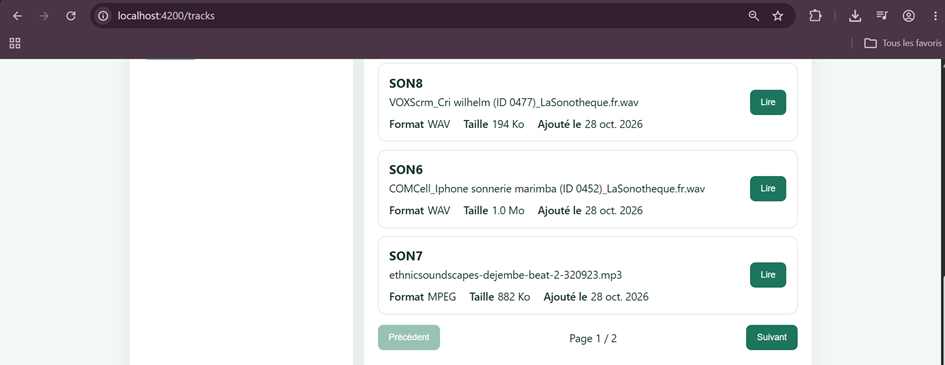
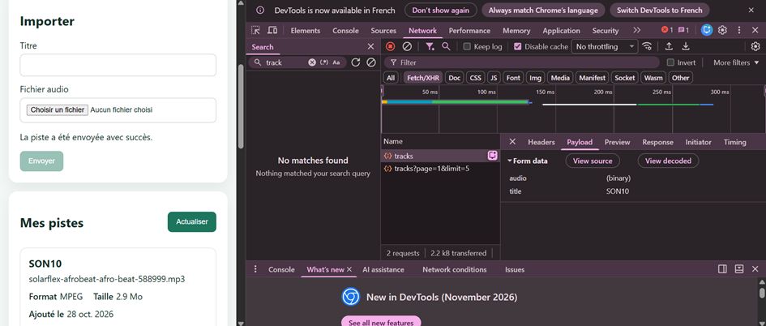
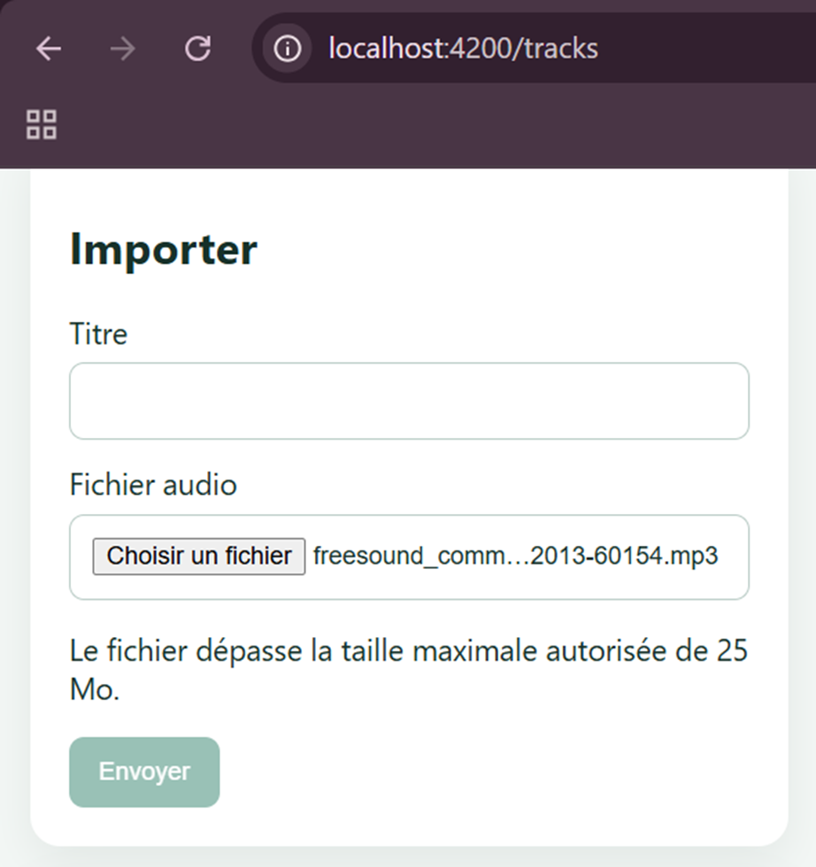
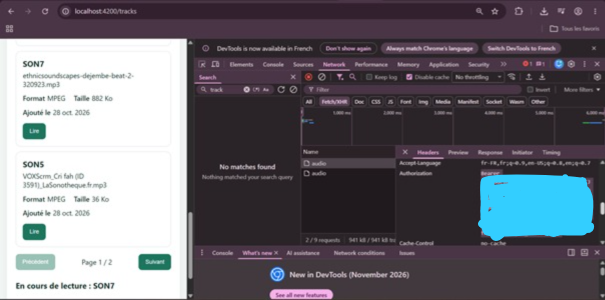
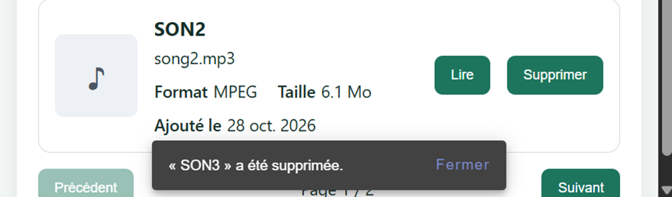
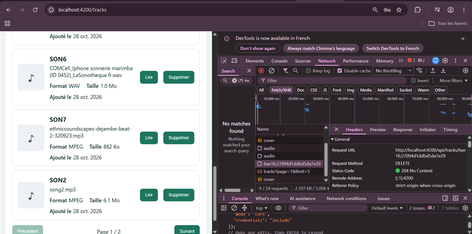

# Rapport d'usage de l'IA - TP1 et TP2

Pour chaque mission, détailler et fournir des explications concernant : objectif; prompt principal; plan proposé par l'agent; vérifications réalisées par le binôme; erreurs ou propositions rejetées; fichiers effectivement modifiés; preuve de fonctionnement; ce que chaque membre sait maintenant expliquer sans l'agent.

---

## Mission 0 — Cartographier l’application
* **Date** : 26 octobre 2026
* **Outil et modèle** : Copilot SDK dans VS Code — mai-code-1.1-flash, puis gpt-6-luna (changement de modèle en cours de session).
* **Objectif** : Cartographier le frontend Angular sans modifier le code : composant racine, routes, enregistrement de `HttpClient`, modèles, services et pages, ajout du JWT, routes publiques/protégées et flux du clic sur « Se connecter ».

### Prompts principaux
1. Demande de lire les consignes du projet et de réaliser la Mission 0 en lecture seule, sans renseigner le rapport à ce stade.
2. « Tu seras mon assistant de développement pour ce projet Angular [...] Travaille uniquement dans ce dossier. [...] On commence par la Mission 0 (cartographie, sans rien modifier) [...] Ne renseigne rien dans le rapport pour l'instant, travaillons étape par étape. »
3. « tu as renseigné quelque chose dans rapport ia modele ? »
4. « oui c'est bon, ajoute, et supprime ce qu'il y avait »

### Analyse réalisée
- Le bootstrap et l’enregistrement de `provideRouter(routes)` et `provideHttpClient(withInterceptors([authInterceptor]))` se trouvent dans `frontend-starter/src/main.ts`.
- Le composant racine est `AppComponent`, défini dans `frontend-starter/src/app/components/app/app.ts`. Son template `app.html` contient le `router-outlet`.
- Les routes sont définies dans `frontend-starter/src/app/routes.ts`. `login` et `register` sont sans `authGuard`; `profile` et `tracks` utilisent `authGuard`.
- Le formulaire de connexion appelle `AuthService.login()`. Le service effectue `POST /api/auth/login`; à la réponse, il conserve le token dans `localStorage` sous `gpc_token` et met à jour ses Signals `token` et `currentUser`. En cas de succès, la page navigue vers `/tracks`.
- `authGuard` vérifie la présence du token avant l’accès aux pages protégées. `authInterceptor`, enregistré au bootstrap, lit le token d’`AuthService` et ajoute l’en-tête d’authentification si un token est présent. L’API login est publique selon le contrat; l’intercepteur peut néanmoins ajouter un en-tête si un ancien token est encore présent.
- Les modèles sont `User`, `AuthResponse`, `Track` et `Page<T>`. Les services sont `AuthService` et `TrackService`. Les pages sont connexion, inscription, profil et pistes audio.

### Schéma annoté du flux au clic sur « Se connecter »
```text
Utilisateur
  └─ clique « Se connecter »
      └─ login-page.html : ngSubmit appelle submit()
          └─ login-page.ts : AuthService.login(email, password)
              └─ auth.service.ts : POST /api/auth/login
                  └─ auth.interceptor.ts : ajoute le JWT si un token est présent
                      └─ réponse { token, user }
                          └─ AuthService stocke le token et met à jour ses Signals
                              └─ subscribe.next() dans login-page.ts
                                  └─ navigation vers /tracks
                                      └─ authGuard vérifie le token
                                          └─ TracksPageComponent s’affiche
```

### Routes de l’API selon `API_CONTRACT.md`
- **Publiques** : `GET /api/health`, `POST /api/auth/register`, `POST /api/auth/login`.
- **Protégées par JWT** : `GET /api/users/me`, `PUT /api/users/me`, `GET /api/tracks?page=1&limit=5`, `POST /api/tracks`, `GET /api/tracks/:id/audio`, `DELETE /api/tracks/:id`.

### Fichiers consultés
- `README.md`
- `API_CONTRACT.md`
- `frontend-starter/AGENTS.md`
- `frontend-starter/best-practices.md`
- `frontend-starter/src/main.ts`
- `frontend-starter/src/app/routes.ts`
- `frontend-starter/src/app/components/app/app.ts`
- `frontend-starter/src/app/components/app/app.html`
- `frontend-starter/src/app/components/login-page/login-page.ts`
- `frontend-starter/src/app/components/login-page/login-page.html`
- `frontend-starter/src/app/shared/services/auth.service.ts`
- `frontend-starter/src/app/shared/services/track.service.ts`
- `frontend-starter/src/app/shared/interceptors/auth.interceptor.ts`
- `frontend-starter/src/app/shared/guards/auth.guard.ts`
- `frontend-starter/src/app/shared/models/user.model.ts`
- `frontend-starter/src/app/shared/models/auth-response.model.ts`
- `frontend-starter/src/app/shared/models/track.model.ts`
- `frontend-starter/src/app/shared/models/page.model.ts`

### Modifications acceptées ou refusées
- Mission 0 : aucune modification du code; cartographie uniquement.
- Rapport : l’ancienne entrée a été remplacée, car elle attribuait à tort un autre outil/modèle et mentionnait des validations, fichiers et détails qui n’avaient pas été consultés ou réalisés dans cette session.
- Aucun changement apporté à la section « Ce que j’ai compris ».

### Commandes lancées
- Aucune commande shell.

### Erreurs et résolutions
- Aucune erreur de commande ou de build; aucune commande n’a été lancée.


---

## Mission 1 — Inscription, connexion et profil
* **Date** : 26 octobre 2026
* **Outil et modèle** : Copilot SDK dans VS Code — gpt-6-luna.
* **Objectif** : Compléter les formulaires d’inscription et de connexion, la gestion locale de l’authentification, la déconnexion, le chargement et la modification du profil, ainsi que le traitement des réponses 401, sans modifier le contrat HTTP ni le backend.

### Prompts principaux
1. Demande d’analyser le code existant de la Mission 1, de proposer les changements et fichiers concernés, puis d’attendre la validation avant toute modification.
2. La Mission 1 demandait des formulaires réactifs et validés, les appels d’inscription/connexion, le stockage du JWT sans le journaliser, la mise à jour de `currentUser`, la déconnexion, le chargement et la modification du profil et le retour à `/login` si un token protégé est invalide ou expiré.
3. « c'est bon je valide »

### Plan proposé et suivi
1. Inspecter les pages et le service d’authentification côté Angular, l’intercepteur, la navigation, le contrat HTTP et les endpoints correspondants du backend.
2. Attendre l’approbation du périmètre avant toute édition.
3. Ajouter les validations et messages d’erreur dans les pages connexion, inscription et profil; conserver les appels HTTP dans `AuthService`.
4. Centraliser l’ajout du JWT et l’expiration de session dans l’intercepteur, ajouter le bouton de déconnexion et charger le profil à l’ouverture de sa page.
5. Lancer le build Angular et les tests disponibles.

### Fichiers consultés
- `API_CONTRACT.md`
- `frontend-starter/package.json`
- `frontend-starter/src/styles.css`
- `frontend-starter/src/app/routes.ts`
- `frontend-starter/src/app/components/app/app.ts`
- `frontend-starter/src/app/components/app/app.html`
- `frontend-starter/src/app/components/app/app.css`
- `frontend-starter/src/app/components/login-page/login-page.ts`
- `frontend-starter/src/app/components/login-page/login-page.html`
- `frontend-starter/src/app/components/login-page/login-page.css`
- `frontend-starter/src/app/components/register-page/register-page.ts`
- `frontend-starter/src/app/components/register-page/register-page.html`
- `frontend-starter/src/app/components/register-page/register-page.css`
- `frontend-starter/src/app/components/profile-page/profile-page.ts`
- `frontend-starter/src/app/components/profile-page/profile-page.html`
- `frontend-starter/src/app/components/profile-page/profile-page.css`
- `frontend-starter/src/app/shared/services/auth.service.ts`
- `frontend-starter/src/app/shared/interceptors/auth.interceptor.ts`
- `frontend-starter/src/app/shared/guards/auth.guard.ts`
- `backend/src/app.js`
- `backend/src/models/User.js`
- `RAPPORT_IA_MODELE.md`

### Modifications acceptées
- `frontend-starter/src/app/shared/interceptors/auth.interceptor.ts` : n’envoie le JWT qu’aux endpoints API protégés; exclut les endpoints publics; sur un `401` d’une requête ayant envoyé le JWT, nettoie la session et redirige vers `/login`. Les refus d’identifiants sur la route publique de connexion ne déclenchent donc pas la déconnexion.
- `frontend-starter/src/app/components/login-page/login-page.ts` et `login-page.html` : champs vides par défaut, validation visible, prévention des doubles soumissions, messages lisibles et journalisation limitée au statut d’erreur.
- `frontend-starter/src/app/components/register-page/register-page.ts` et `register-page.html` : validations du nom, de l’adresse e-mail et de la longueur minimale du mot de passe; messages adaptés, prévention des doubles soumissions et message spécifique pour une adresse déjà utilisée.
- `frontend-starter/src/app/components/profile-page/profile-page.ts` et `profile-page.html` : chargement automatique du profil à l’ouverture, états de chargement/réussite/erreur, validation du nom et mise à jour via `AuthService`.
- `frontend-starter/src/app/components/app/app.ts` et `app.html` : ajout du bouton de déconnexion qui nettoie l’état local et revient à `/login`.
- Aucun changement du backend, de `API_CONTRACT.md` ou de `AuthService`; les appels API et le stockage du JWT existaient déjà dans `AuthService`.

### Vérifications et commandes lancées
- `npm run build` : première tentative depuis le dossier parent du frontend, échouée car ce dossier ne contient pas `package.json`; relancée depuis `frontend-starter`, réussie.
- `npm run build` depuis `frontend-starter` après les changements : réussi (bundle Angular généré).
- `npm test` depuis `frontend-starter` : non exécuté jusqu’au bout, car l’environnement DOM requis par Angular est absent (`jsdom` ou `happy-dom` manquant). Aucun paquet n’a été ajouté.
- Recherche de fichiers `*.spec.ts` sous `frontend-starter/src` : aucun fichier de test correspondant trouvé.

### Erreurs et résolutions
- Mauvais répertoire de travail lors de la première commande de build : corrigé en relançant la commande depuis `frontend-starter`.
- Suite de tests indisponible faute d’environnement DOM; build de production réussi. La dépendance manquante n’a pas été installée afin de ne pas élargir le changement.

### Ce que j’ai compris (à rédiger par l’étudiante)

J’ai compris comment se déroule l’authentification dans l’application, de l’inscription à la connexion. Lorsqu’un utilisateur s’inscrit ou se connecte, Angular envoie une requête à l’API. Après une connexion réussie, le token JWT est enregistré dans le navigateur pour permettre l’accès aux pages protégées.

J’ai aussi compris que le JWT est envoyé lors des requêtes qui nécessitent une authentification. Enfin, le profil permet de récupérer les informations de l’utilisateur et de modifier son nom grâce au service d’authentification.

---

## Mission 2 — Bibliothèque paginée, upload et lecture audio
* **Date** : 28 octobre 2026
* **Outil et modèle** : Copilot SDK dans VS Code — gpt-6-luna.
* **Objectif** : Vérifier et compléter la pagination serveur, améliorer la validation et les retours d’état de l’upload, puis compléter la lecture audio authentifiée. Dans une étape facultative ultérieure, ajouter un filtre serveur, une suppression confirmée et l’upload d’une image de couverture.

### Prompts principaux
1. « salut, continuons avec le TP2 que je reprend » puis choix de commencer par un état des lieux du TP2.
2. « ok donc commençons etape par etape »
3. Confirmation que les changements de page fonctionnaient et que Network affichait `tracks?page=X&limit=5` avec un statut `200`.
4. Demande d’explication du choix du fichier, de `FormData`, du flux et du rôle du Blob par rapport au JWT.
5. Confirmation des tests d’upload : fichier de plus de 25 Mo refusé avec un message d’erreur, puis petit fichier envoyé avec les champs `audio` et `title`.
6. Confirmation que la lecture audio répondait `200` avec le JWT dans `Authorization`.
7. Demande de consigner le travail dans le rapport.
8. Demande de poursuivre avec les améliorations facultatives et les couvertures; choix validé : filtre côté serveur, suppression avec confirmation, couverture téléversée, et autorisation de modifier le backend et le contrat API.

### Plan proposé et suivi
1. Lire le sujet TP2, les consignes frontend, le composant de bibliothèque, le service de pistes, le modèle et les endpoints backend correspondants.
2. Terminer l’affichage des états de pagination et les contrôles de navigation, tout en conservant la pagination côté serveur.
3. Compléter la validation frontend et les retours d’état du formulaire d’upload.
4. Compléter l’état de lecture audio, les erreurs, les cartes de pistes et la libération de l’ObjectURL.
5. Construire le frontend et demander la vérification manuelle des requêtes dans Network.

### Analyse et flux expliqués
- `tracks-page.html` contient le champ `type="file"` qui déclenche `choose($event)`. La méthode `choose()` dans `tracks-page.ts` récupère le fichier sélectionné.
- La méthode `upload()` transmet le fichier et le titre à `TrackService.upload()`. Dans `track.service.ts`, le service crée un `FormData`, ajoute les champs requis `audio` et `title`, puis envoie `POST /api/tracks`. L’extension facultative ajoute `cover` lorsqu’une image est choisie.
- Le backend traite maintenant les fichiers avec `upload.fields()` : `audio` est obligatoire; `cover` est facultatif. Il limite l’audio à 25 Mo, la couverture à 5 Mo et filtre les types MIME acceptés. La signature de l’image est également vérifiée après réception. Ces contrôles restent nécessaires même si le frontend valide aussi les fichiers, car une validation côté navigateur peut être contournée.
- Pour la lecture, `play(track)` appelle `TrackService.audio(id)`, qui utilise `HttpClient` avec `responseType: 'blob'`. L’intercepteur ajoute le JWT à la requête API protégée; le Blob est la réponse binaire audio, pas le JWT. Le composant crée une ObjectURL pour fournir les octets reçus au lecteur HTML.
- Une URL placée directement dans `src` d’un élément `<audio>` ne passe pas par `HttpClient` et ne reçoit donc pas automatiquement l’en-tête `Authorization` ajouté par l’intercepteur.
- Le backend utilise `res.sendFile()` pour envoyer le fichier stocké sur disque. Avec `HttpClient` et `responseType: 'blob'`, le composant reçoit généralement le Blob une fois la réponse téléchargée. La liste ne récupère que les métadonnées; l’audio est demandé à la lecture. Un lecteur HTML pointant directement vers une URL HTTP délègue le chargement et le buffering au navigateur, dont le comportement dépend entre autres de `preload`.
- Une ObjectURL est révoquée quand elle est remplacée et à la destruction du composant afin de libérer la ressource associée.

### Modifications acceptées
- `frontend-starter/src/app/components/tracks-page/tracks-page.ts` :
  - passage explicite de la page et de la limite de cinq pistes à `TrackService.list()` ;
  - états d’erreur et de chargement pour la bibliothèque, et protection contre les réponses d’une ancienne requête ;
  - contrôle des limites de pagination ;
  - validation frontend des types MIME audio acceptés par le backend et de la taille maximale de 25 Mo ;
  - états de soumission, prévention des doubles envois, retours de succès/erreur et remise à zéro du formulaire après succès ;
  - état du morceau en cours, erreurs de récupération/lecture et révocation de l’ObjectURL finale à la destruction.
- `frontend-starter/src/app/components/tracks-page/tracks-page.html` : messages accessibles avec `role="status"`/`role="alert"`, états du formulaire, cartes de pistes et lecteur audio associé au morceau en cours.
- `frontend-starter/src/app/components/tracks-page/tracks-page.css` : présentation responsive des cartes de bibliothèque.
- Aucun changement du backend ou du contrat HTTP pour les missions principales; les changements nécessaires aux options facultatives sont documentés séparément ci-dessous.

### Vérifications et commandes lancées
- `npm run build` depuis `frontend-starter` après la pagination : réussi.
- Vérification manuelle par l’étudiante dans Network : les changements de page envoient `GET tracks?page=X&limit=5`, réponse `200`.
- Vérification manuelle par l’étudiante : un fichier de plus de 25 Mo est refusé avec un message d’erreur.
- Vérification manuelle par l’étudiante : l’upload d’un petit fichier audio envoie correctement les champs multipart `audio` et `title`.
- `npm run build` après les modifications d’upload : réussi.
- Vérification manuelle par l’étudiante : la requête audio reçoit `200` et comprend le JWT dans l’en-tête `Authorization`.
- `npm run build` après les modifications de lecture et des cartes : réussi.
- `npm test` n’a pas pu démarrer : Angular a signalé l’absence d’un environnement DOM (`jsdom` ou `happy-dom`). Aucun paquet n’a été installé. Aucun fichier de test frontend `*.spec.ts` n’a été trouvé.

### Captures d’écran
- **Pagination et cartes de bibliothèque** — 
- **Upload multipart dans Network** — 
- **Validation de taille** — 
- **Lecture audio authentifiée** — 
- La valeur du JWT doit rester masquée sur toute capture partagée.


### Ce que j’ai compris
J’ai compris que le choix du fichier est traité par le composant, puis que le service construit le `FormData` et envoie les champs `audio` et `title` à l’API. La validation faite dans le navigateur donne un retour rapide à l’utilisateur, mais le backend doit refaire les contrôles, car il ne peut pas faire confiance au client.

Pour la lecture, le JWT est envoyé dans l’en-tête HTTP par l’intercepteur, tandis que le Blob contient les octets audio reçus. Une ObjectURL permet au lecteur HTML d’utiliser ce Blob. Les fichiers ne sont pas téléchargés au chargement de la liste : seule la piste demandée est récupérée à la lecture. J’ai vérifié dans Network la pagination, l’upload et la requête audio authentifiée.


### Améliorations facultatives — filtre, suppression et couvertures
- **Choix validé** : filtre par titre côté serveur (combiné à la pagination), suppression avec confirmation, et upload d’une image associée à la piste. L’étudiante a autorisé les changements du backend et du contrat API.
- **Couverture** : JPEG, PNG ou WebP, 5 Mo maximum. Le backend stocke l’image sur disque, conserve ses métadonnées dans MongoDB et vérifie aussi la signature du fichier. Le nom de stockage n’est pas renvoyé au frontend. `GET /api/tracks/:id/cover` vérifie le JWT et le propriétaire; Angular utilise `HttpClient` pour joindre le JWT, reçoit l’image en Blob et crée une ObjectURL. La suppression d’une piste tente aussi de supprimer sa couverture.
- **Filtre** : `search` est transmis avec la pagination. Le backend échappe les caractères regex pour effectuer une recherche littérale partielle et insensible à la casse sur le titre.
- **Suppression** : confirmation native du navigateur, requête `DELETE /api/tracks/:id`, message de résultat et rafraîchissement de la page courante (retour à la page précédente si la dernière piste de la page vient d’être supprimée).
- **Correction après essai d’upload** : le middleware multipart renvoyait `Too many parts` pour le formulaire audio + titre + couverture. Busboy signale la limite dès que le nombre de parties atteint la valeur configurée; le plafond est donc réglé à 4 pour accepter les trois champs attendus. Les limites indépendantes restent fixées à deux fichiers et un champ texte.
- **Fichiers modifiés pour ces options** : `API_CONTRACT.md`; `backend/src/app.js`, `backend/src/models/Track.js`, `backend/test/api.test.js`; `frontend-starter/src/app/components/tracks-page/tracks-page.ts`, `tracks-page.html`, `tracks-page.css`; `frontend-starter/src/app/shared/services/track.service.ts` et `shared/models/track.model.ts`.
- **Validations automatisées** : `npm run build` frontend réussi; `npm test` backend réussi (3 tests); `node --check` sur `backend/src/app.js` et `backend/src/models/Track.js` réussi. Le test ajouté vérifie la protection JWT de la route cover et le fait que le nom de stockage de couverture n’est pas exposé.
- **Vérification manuelle par l’étudiante** : après le réglage de la limite multipart à 4, l’upload d’une piste avec son champ `cover` fonctionne.
- **Vérification manuelle par l’étudiante** : le filtre par titre fonctionne, les couvertures s’affichent, et la suppression avec confirmation et rafraîchissement fonctionne.

### Captures TP3 — suppression d’une piste
- **Confirmation visuelle après suppression** — 
- **Requête DELETE dans Network** — 
- La capture Network confirme la requête `DELETE` et la réponse `204 No Content`; aucune donnée d’authentification n’est visible.

---

## Note — Installation des dépendances du frontend
- Une première commande `npm install` destinée à Angular Material/CDK a été lancée par erreur dans le dossier parent du projet. Elle y a créé `node_modules/`, `package.json` et `package-lock.json`.
- Ces éléments ont été conservés à la demande de l’étudiante. Ils sont séparés du projet `AngularM1_Miage_2026_2027_TP123-main/frontend-starter`, qui possède son propre `package.json`, son `package-lock.json` et ses dépendances locales; ils ne sont pas requis pour exécuter le frontend.
- Angular Material et CDK ont ensuite été installés dans `frontend-starter` aux versions compatibles avec Angular 22.1.4. C’est cette installation qui est utilisée par l’application.

---

## TP3 — Suppression, progression d’upload et tests automatisés
* **Date** : 29 octobre 2026
* **Outil et modèle** : Copilot SDK dans VS Code — modèle utilisé dans l’interface (à compléter).
* **Objectif** : vérifier la suppression authentifiée d’une piste, traiter les états de progression et d’échec de l’upload, et écrire des tests frontend ciblés indépendants du backend.

### Déroulement et explications
- La suppression est déclenchée par le composant, qui demande confirmation, empêche une deuxième suppression simultanée et présente le résultat dans un SnackBar. La requête `DELETE /api/tracks/:id` est centralisée dans `TrackService`. Après succès, la liste est rechargée; si le backend renvoie `404` (piste absente ou non accessible), une erreur est affichée et l’utilisateur peut actualiser la liste.
- Le backend authentifie chaque requête et cherche la piste par identifiant et propriétaire. Le guard et l’interface Angular ne remplacent pas cette vérification serveur.
- L’upload utilise les événements HTTP Angular. Le composant met à jour le pourcentage à partir de `loaded / total`; si `total` n’est pas communiqué, la progression est indéterminée. En cas d’erreur HTTP ou de coupure, l’envoi s’arrête, la barre disparaît, le message d’erreur s’affiche et le titre/fichier restent sélectionnés pour permettre un nouvel essai. Après succès, le formulaire est réinitialisé.
- Les tests frontend utilisent `HttpTestingController` pour intercepter les requêtes et fournir des réponses simulées; ils n’ont donc besoin ni d’Express ni de MongoDB.

### Fichiers TP3 concernés
- `frontend-starter/src/app/components/tracks-page/tracks-page.ts` et `tracks-page.html` : confirmation/état de suppression, notifications SnackBar, message pour les erreurs HTTP 403/404, progression et états d’erreur/succès de l’upload.
- `frontend-starter/src/app/shared/services/track.service.ts` : `DELETE` centralisé et upload observé sous forme d’événements HTTP avec `reportProgress`.
- `frontend-starter/src/app/shared/services/track.service.spec.ts` : tests du listing paginé/filtré, suppression, en-tête de l’intercepteur et événements d’upload.
- `frontend-starter/package.json` et `package-lock.json` : Angular Material/CDK alignés sur Angular 22.1.4 et `happy-dom` pour l’environnement des tests.
- `frontend-starter/angular.json` : configuration `development` requise par le runner de test.
- `frontend-starter/src/styles.css` : thème Angular Material pour le SnackBar.
- Aucun changement backend n’a été nécessaire pour ces missions.

### Vérifications et résultats
- `npm test` depuis `frontend-starter` : **4 tests réussis**.
- `npm run build` depuis `frontend-starter` : **réussi**.
- `npm test` depuis `backend` : **3 tests réussis**.
- Vérification manuelle effectuée par l’étudiante : suppression confirmée dans l’interface et dans Network; la requête `DELETE` retourne `204 No Content`. Captures dans `captures-tp3/`.
- **Vérification manuelle de l’upload** : l’étudiante a réglé le throttling de Network sur « 3G » pour ralentir l’envoi et rendre la progression visible. La capture montre l’upload actif à 0 % et les contrôles du formulaire désactivés (voir `captures-tp3/upload-progression-3g.png`). Après l’envoi, la piste apparaît dans la liste; aucune capture supplémentaire de la réponse finale n’est jugée nécessaire par l’étudiante. Les tests simulent les événements et la capture documente l’état de progression.
- La capture Network d’upload déjà présente dans la section TP2 ([image-2.png](./image-2.png)) montre la requête multipart avec les champs `audio` et `title`; elle complète la capture d’interface de progression 3G. La capture Network de suppression est `captures-tp3/suppression-network-204.png`.

### Rapport détaillé des tests frontend
| Test | Résultat attendu | Résultat observé |
|---|---|---|
| Liste avec pagination et recherche | `GET /api/tracks` contient `page=2`, `limit=5`, `search=blues`; la page simulée contient une piste. | URL, méthode, paramètres vérifiés; une piste reçue. Réussi. |
| Suppression | `DELETE /api/tracks/track-1`; l’observable se termine après la réponse `204`. | Méthode et URL vérifiées; complétion observée après la réponse simulée. Réussi. |
| Intercepteur | Une requête protégée inclut l’en-tête `Authorization` avec le préfixe `Bearer` et le jeton de test. | En-tête vérifié sur la requête interceptée. Réussi. |
| Upload avec progression | `POST /api/tracks` contient `FormData` (`audio`, `title`), active `reportProgress` et émet progression puis réponse finale. | Méthode, corps et option vérifiés; événements `Sent`, `UploadProgress` (50 %) puis `Response` observés. Réussi. |

### Compréhension à restituer
Les tests HTTP simulés contrôlent ce que le frontend envoie (méthode, URL, paramètres, headers et corps) et comment il reçoit les événements/réponses; ils ne valident pas l’intégration réelle avec le backend. Un test d’intégration relie plusieurs parties du système (par exemple frontend, API et base de données), tandis que ces tests ciblés isolent surtout le service et l’intercepteur.

L’étudiante a expliqué que `HttpTestingController` intercepte les appels Angular et fournit une réponse simulée, ce qui permet de tester sans serveur ni MongoDB.
